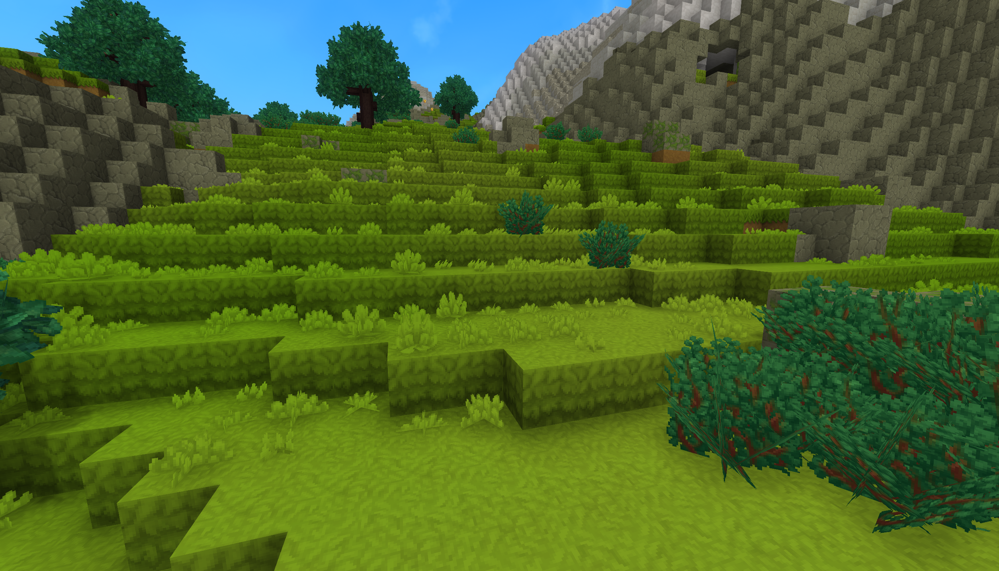
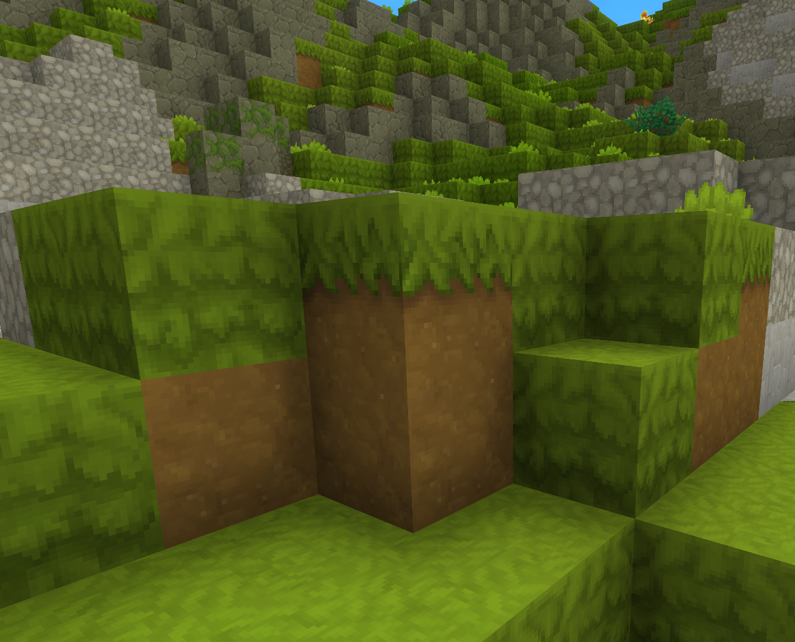
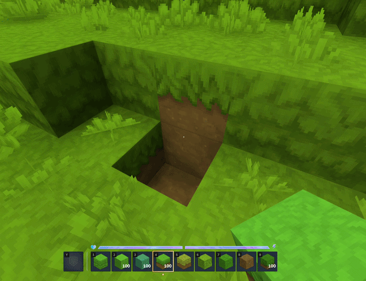

# HiWire - BetterGrass v0.1.0

Grass covers the sides of blocks on hills and slopes, instead of leaving a strip of bare dirt.



 



## Features

- **Better Grass Sides** - Grass blocks get full-grass sides where the terrain steps down, instead of a dirt edge on every slope
- **Every Grass Type** - Works on all seven grass families: normal, Lush, Dry, Cold, Sunny, Wet and Withered
- **Leafy Soil Too** - Leaf litter gets the same treatment, and reads as one continuous surface with grass
- **Fixed Grass Blending** - Corrects the transitions between grass types, which in vanilla blend both ways at once and stack two masks on the same edge
- **Fixed Sunny Grass** - Repairs a vanilla bug where Sunny Grass could not be tinted, leaving its blend a fixed green that clashed with grass, dirt and stone alike
- **Works While You Build** - Grass you place turns full when it qualifies, and the blocks around one you dig update straight away
- **Automatic** - No commands to run, no world pre-processing; terrain converts as players explore

## Why this mod?

Hytale already ships the artwork for this. Every grass block has a `_Full` sibling whose sides use
the grass texture instead of dirt-with-a-fringe, and worldgen places those variants by hand in a
handful of zone definitions. Nothing swaps to them while you play, so a stepped hillside shows a
band of dirt on every terrace instead of a continuous grass slope.

BetterGrass simply wires up what is already there.

Doing so exposed two vanilla asset bugs, which the mod also fixes:

- **Grass types blend both ways at once.** Every grass variant belongs to the same block group, so
  "blend onto other grass" and "blend onto my own kind" are the same instruction. Two neighbouring
  blocks each paint their edge onto the other, stacking two masks on one seam.
- **Sunny Grass cannot be tinted.** It is the only grass family shipping baked-colour textures with
  its tinting switched off, so its blend is stuck at one fixed green regardless of what it meets.

## Requirements

- Hytale or Hytale Server
- Java 25

## Installation

### Using CurseForge App

The easiest way to install mods is via the [CurseForge App](https://www.curseforge.com/download/app), which handles installation and updates automatically.

### Manual Installation

1. Download the mod JAR file
2. Place it in the mods directory:
   - **Windows:** `%appdata%\Hytale\UserData\Mods`
   - **Mac:** `~/Library/Application Support/Hytale/UserData/Mods`
   - **Linux (Flatpak):** `~/.var/app/com.hypixel.HytaleLauncher/data/Hytale/UserData/Mods`
   - **Dedicated Server:** `/mods` folder in your server directory
3. Restart the game or server

Since Hytale uses a server internally for both singleplayer and multiplayer, this mod works in both modes.

Only the server or world host needs the mod. Players connecting to a modded server see the improved
grass without installing anything.

## How It Works

A grass block switches to its full-grass variant when an **exposed side has grass diagonally below
it** - the stepped hillside case. Faces hidden behind a solid block are ignored, since they are
never drawn, and a block with no exposed side is left alone.

Conversion happens in three places, so there is nothing to run by hand:

| When | What |
|------|------|
| A chunk loads | The interior is converted before anyone is sent the chunk, so the change is invisible |
| A chunk becomes live | The edges are finished, which need the neighbouring chunk to decide |
| You place or break a block | The grass around it updates immediately |

Existing worlds convert as players explore them. Newly generated terrain arrives already converted.

### Is it safe for my world?

The mod changes real blocks rather than only their appearance, because Hytale block textures are
per block type and the renderer cannot be modded. That is safe here for three reasons:

- Both variants inherit from the same parent block, so **material, group, tools and drops are
  identical**. Nothing that reacts to block type can tell them apart.
- The mod refuses to convert any pair whose halves do not drop the same items, so an asset change
  in a future Hytale update cannot turn the conversion into an item duplication exploit.
- The rule is **one-way**. A full-grass block is never converted back, because it may be one a
  player crafted and placed deliberately.

## Commands

| Command | Description | Executor | Permission |
|---------|-------------|----------|------------|
| `/bettergrass` | Root command for BetterGrass | Any | `hiwire.bettergrass.command.bettergrass` |
| `/bettergrass enabled [true\|false]` | Show or set whether conversion runs | Player only | `hiwire.bettergrass.command.bettergrass.enabled` |
| `/bettergrass explain <x> <y> <z>` | Explain why a block did or did not convert | Player only | `hiwire.bettergrass.command.bettergrass.explain` |

### Examples

Check whether conversion is running:

```
/bettergrass enabled
```

Turn conversion off. Blocks already converted stay as they are:

```
/bettergrass enabled false
```

Find out why a particular block still has dirt sides:

```
/bettergrass explain -956 136 160
```

`explain` reports every side of the block: what is next to it, whether that hides the face, what
sits diagonally below, and the verdict. It also prints to the server log.

## Grass Blending

Vanilla lets grass types blend in both directions at once, so a seam between two types wears both
of their edges. BetterGrass gives each family its own block group and a single blending direction,
following the precedence the game already uses:

```
Cold > Lush > Sunny > Dry > Withered > Wet > Grass
```

Each type blends onto the ones below it and none above, so every boundary gets exactly one edge.
Normal, Withered and Wet grass blend into each other as well, which vanilla does not do at all.

Blocks that blend onto grass from outside the family - snow, mud, leaf litter, moss, ice - keep
working on every grass type.

## Customization

Everything the mod changes lives in plain asset files inside the JAR, under
`Server/Item/Items/Soil/Grass`. An asset pack of your own that overrides the same files takes
precedence, so the blending order or any individual texture can be changed without rebuilding.

## Building from Source

```bash
./gradlew build
```

The compiled mod JAR will be in `mod/build/libs/`.

Regenerating the asset overrides after a Hytale update:

```bash
python3 tools/generate_grass_overrides.py \
    --assets /path/to/HytaleAssets/Server/Item/Items \
    --out    mod/src/main/resources/Server/Item/Items \
    --textures-out mod/src/main/resources/Common/BlockTextures
```

Add `--verify` to check the shipped files are current without writing anything. The overrides are
copies of the vanilla assets with two fields changed, so they need regenerating whenever Hytale
updates those files.

## License

MIT License

Copyright (c) 2026 HiWire Studio

Permission is hereby granted, free of charge, to any person obtaining a copy
of this software and associated documentation files (the "Software"), to deal
in the Software without restriction, including without limitation the rights
to use, copy, modify, merge, publish, distribute, sublicense, and/or sell
copies of the Software, and to permit persons to whom the Software is
furnished to do so, subject to the following conditions:

The above copyright notice and this permission notice shall be included in all
copies or substantial portions of the Software.

THE SOFTWARE IS PROVIDED "AS IS", WITHOUT WARRANTY OF ANY KIND, EXPRESS OR
IMPLIED, INCLUDING BUT NOT LIMITED TO THE WARRANTIES OF MERCHANTABILITY,
FITNESS FOR A PARTICULAR PURPOSE AND NONINFRINGEMENT. IN NO EVENT SHALL THE
AUTHORS OR COPYRIGHT HOLDERS BE LIABLE FOR ANY CLAIM, DAMAGES OR OTHER
LIABILITY, WHETHER IN AN ACTION OF CONTRACT, TORT OR OTHERWISE, ARISING FROM,
OUT OF OR IN CONNECTION WITH THE SOFTWARE OR THE USE OR OTHER DEALINGS IN THE
SOFTWARE.

## Support

- **Author:** HiWire-Nick
